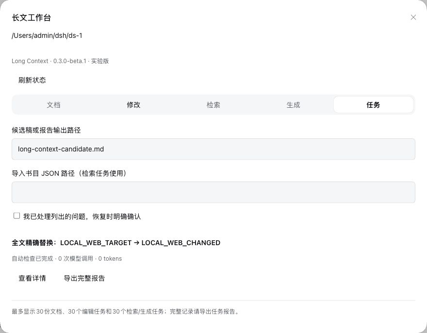

# dsh-long-context

面向 DSH `0.2.0-rc.2` 的长文档主题修改插件。当前提供实验性的文本编辑、组合检索及逐页生成核心：保存不可变原文、全文审查覆盖、影响项与依赖、候选稿、版本绑定验证及持久任务恢复。

已实现独立 `long-context` preset、23 个 `lc_*` 工具和 compaction 扩展。默认保留原稿，修改写入新候选文件；未完成覆盖、未解决依赖、陈旧版本和缺失检查会阻止 `lc_finish`。

当前支持 UTF-8 TXT、Markdown、单文件 LaTeX 的文本操作，以及原生文本 PDF 的证据提取与质量问题定位。已接入 Crossref 元数据分页和结构化全文导入；科学问题、滚动五年窗口、组参与证据、原文语言与 51 篇配额均有门槛。生成按 30–100 个逻辑单元推进，恢复前章摘要、准确原文和定义，配置本地 LibreOffice 后核对实际 PDF 页数和完整正文。

版本 `0.3.0-beta.1` 仍为实验性预览：真实 51 篇检索、完整科学内容质量与全部优化计划尚未通过验收。中文全文不是 Crossref 自动提供；语言识别有保守词法限制。DOCX 原位写回、单文件 LaTeX 的受管编译、OCR、多文件 LaTeX、原 PDF 版面保留及生成任务与编辑任务的自动衔接均未交付。缺少编译器时 LaTeX 格式保持 `unknown`；缺少渲染器时逻辑页数不能被算作物理页数通过。

## Web 工作台（0.3.0-beta.1）

现已提供原生 DSH Web 客户端。新建工作区会话选择 **Long Context**，发送首条消息创建会话后，点击会话标题栏的 **长文工作台**。文档、修改、检索、生成、任务五个页签直接调用当前会话的原生工具，可导入文档、创建及推进任务、显式接管恢复、导出报告。Standard 会话显示切换提示；不会自动更换已有会话的模式。

根包入口现在是 Web 插件；手动组合 headless preset 的调用方继续使用 `dsh-long-context/agent`、`/host`、`/compaction`，纯核心使用 `/core`。Web 入口必须以裸包名加入 bundle，才能由原生客户端模块发现。所有 DSH peer 精确锁定 `0.2.0-rc.2`；其他版本尚未验证。

本地安装、npm 发布准备和市场投稿见 [安装与发布说明](docs/WEB_INSTALLATION_AND_RELEASE.zh.md)，实际 3080 验收见 [Web 部署报告](docs/WEB_DEPLOYMENT_REPORT.zh.md)。本轮按用户要求暂不发布 npm 或提交市场 PR。



## 开发与验证

要求 Node.js ≥22.13、pnpm 11.1.2；本机验证使用 Node.js 24.19.0。DSH 与 Cordis 使用锁定版本，采用 hoisted 依赖布局。

```sh
pnpm install --frozen-lockfile
pnpm typecheck
pnpm lint
pnpm test
pnpm build
pnpm pack --pack-destination .acceptance
pnpm acceptance:preflight
pnpm acceptance:web:rc2
pnpm acceptance:mechanisms:rc2
```

集成测试会在仓库 `.acceptance/native/dsh-home-v2` 建立独立 profile 并安装本次 tgz，不改变用户原有 DSH home。机制测试使用本地受控 provider，验证实际 DSH 请求中的 checkpoint、压力压缩、手动压缩、overflow 重试及压缩后的文本编辑闭环；这些结果不代表真实模型的语义质量。

真实模型测试需另行配置已授权的隔离 headless profile：

```sh
LC_MODEL_PROFILE=my-authorized-test-profile pnpm acceptance:model:rc2 /absolute/path/task.txt
```

缺少测试 profile 或任务文件时，该命令记录 `not-run` 并以状态码 2 退出，不复制用户原 home 的密钥。

## 安装与使用

构建打包后，将 tgz 安装到目标 Web profile：

```sh
dsh plugin --profile my-web-profile add /absolute/path/dsh-long-context-0.3.0-beta.1.tgz
```

重启相应 Web profile，在新会话中选择 **Long Context**。该 preset 只提供文档任务工具与提问工具，不暴露终端、任意代码执行和委托工具。安装不会将它设置为 standard 或所有会话的默认预设。

基本流程：`lc_import` → `lc_task_start` → 重复 `lc_scan_next` → `lc_impact_review` → `lc_plan` → `lc_apply` → 逐块 `lc_verify` → `lc_finish` → `lc_export_report`。使用 `lc_inspect` 获取块定位，使用 `lc_read` 的 `nextCursor` 完整续读；写工具携带最新 `expectedLedgerRevision` 和稳定的 `requestId`。

- `lc_status` 分页查看权威账本；搜索命中不能代替全文审查。
- `taskType: exact` 按冻结的字面替换目标独立核对整篇，模型调用为 0；语义修改可通过 `rootChanges` 指定必须落地的词或段落。
- 扫描与复核沿用当前 DSH 模型 route；失败范围保持未完成，调用有重试和预算限制。
- `lc_resume` 从账本恢复；跨会话接管需要显式 `transferOwner`，fork 不自动获得写权。
- `lc_rollback` 在 hash/version 校验后将基线恢复到插件管理的候选文件，保留原稿。
- headless 组合使用 `bundle/headless.patch.yml`，不与默认 compaction provider 重复加载。

卸载：`dsh plugin --profile my-web-profile remove dsh-long-context`。卸载解除插件配置，默认保留工作区 `.dsh-long-context/` 中的任务数据；需清理时先自行备份与确认范围。该目录包含原文和模型请求内容，不应提交到公共仓库。

## 检索、生成与迁移

检索流程：`lc_research_start` → `lc_research_next` 联网召回 → `lc_research_import` 导入 JSON 书目与已导入正文 → 逐窗口 `lc_research_next` → `lc_research_finish`。Paper 输入包括 title、authors、published（首次公开日期）、sourceUrl、revisionId，DOI/arXiv 标识可选。每篇需 `participationEvidence`，它是连接论文、作者与准确组名的证据 anchor；只有同名作者或同机构不能通过。已知更早 arXiv 版本会排除；未知首次公开日期仍需人工核查。元数据、中文摘要或翻译不能替代原始中文正文。自行导入译文且未提供原稿时，当前算法无法自动鉴定翻译来源，原文语言必须人工核查。

生成流程：`lc_generate_start` 提供 title、pages、每个逻辑单元一个 outline 目标、revisionIds 和 definitions → 重复 `lc_generate_next` → `lc_generate_finish`。独立复核只检查当前单元并绑定准确证据编号。失败页与错误反馈保留，`lc_resume` 后可修订；新工作流的调用、token、墙钟预算冻结在账本。每个逻辑单元不足 400 个有效文字/数字/符号时不能靠分页通过；这只是内容量保护，仍需要科学质量审阅。`lc_generate_revise` 接收新 definitions、可选 revisionIds，保留旧 journal 与产物，撤销全部依赖单元后重生成。自动父子编辑联动尚未实现。

Host 配置可选 `auxiliaryModel: {provider, model, reasoningEffort, maxOutputTokens, deadlineMs}`、`rendererExecutable` 和 `rendererFontconfigFile`。推理档位须由当前模型支持；渲染器和字体必须在部署机器上完成校准。测试使用了显式配置的 LibreOfficeDev，本包不捆绑或自动安装渲染器。PDF 存放于私有账本 artifacts，可编辑源写入受管候选路径；文档工具禁止读写账本内部路径。

schema v1 不能被 v2 运行时直接写入。先停用相关 workspace 的旧服务、备份原文与候选，然后执行：

```sh
node scripts/migrate-state.mjs /absolute/workspace .dsh-long-context
node scripts/migrate-state.mjs /absolute/workspace .dsh-long-context --rollback
```

迁移采用新 generation，保留旧 journal、owner 与幂等回执；旧完成任务显示为 legacy_checks。回退只恢复 v1 指针，v2 数据保留，需配合旧插件版本使用；刷新 `lc_status` 获取迁移后的 CAS。脚本位于源码仓库，打包版本同时从 `dsh-long-context/core` 导出 migrateV1/rollbackMigration。

## 评测与文档

`pnpm evaluate:fixtures` 生成 10 份各 100 页的固定文本样本，原文在隔离工作区，gold 在 `evaluation/gold/`，不能把 gold 提供给模型。`evaluate:gold` 对指定原稿和候选稿评分，`evaluate:report` 汇总任务成功率和置信区间。没有实际运行的指标保持未知。

完整运行证据位于本地 `evaluation/runs/`，依赖、测试数据、运行请求、打包产物与缓存均被 Git 忽略。发布包仅包含编译代码、bundle、文档和许可证，不包含论文或测试运行记录。

- [优化执行报告与剩余事项](docs/OPTIMIZATION_EXECUTION_REPORT.zh.md)
- [测评后的完整优化实施计划](docs/OPTIMIZATION_IMPLEMENTATION_PLAN.zh.md)
- [插件测评报告及优化建议](docs/PLUGIN_EVALUATION.zh.md)
- [开发状态及当前限制](docs/DEVELOPMENT_STATUS.zh.md)
- [完整实施计划](docs/IMPLEMENTATION_PLAN.zh.md)
- [本机实际验收计划](docs/ACCEPTANCE_PLAN.zh.md)
- [DSH 兼容基线](docs/DSH_COMPATIBILITY.zh.md)
- [领域术语](CONTEXT.md)

补充验收：`pnpm evaluate:relevance` 使用当前授权的模型路由审阅真实论文可读文字；`pnpm evaluate:performance` 测合成密集文本与输入上限，分隔单元不等于物理页数。`pnpm evaluate:optimization-report` 汇总本机运行结果；先构建并完成对应验收，禁止将未执行项写为通过。
